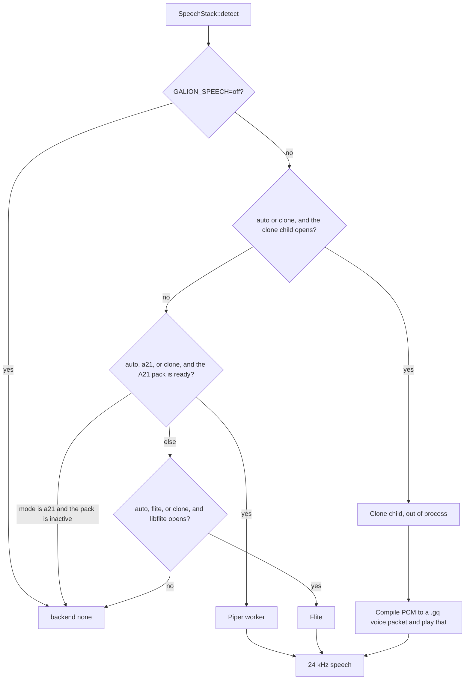
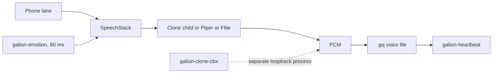

# Galion Voice V2

[](LICENSE)
[](https://www.rust-lang.org)
[](docs/galion-voice-v2/symphony/CLONE-LANDING.md)

Perpetual Open MIT License. © 2026 Maciej Grajczyk.

Galion Voice is one voice on one mark. You speak on the **you** band. Galion answers on the **me** band. A **feeling** band carries a few bytes of emotion each frame, and only when consent allows it. Consent starts denied.

The clock does not move: 80 ms, 12.5 Hz, 24 kHz, from [`LOCKS.toml`](LOCKS.toml). The slogan is "The seamless connection with the human being, on the voice only."

**V1** is the foundation (one-dot console, heartbeat, English cascade, Piper, the phone path). **V2** is this program. **V3** is later. Nothing in this tree has been deployed.

## Contents

- [What you are looking at](#what-you-are-looking-at)
- [Main components](#main-components)
- [Synthesis stack](#synthesis-stack)
- [Build and run](#build-and-run)
- [Laptop GPU and cloning](#laptop-gpu-and-cloning)
- [Where to read next](#where-to-read-next)
- [Licence](#licence)

## What you are looking at

The live surface is one orb. It rests, listens, thinks while a turn is in flight, and moves with the reply you actually hear. There is no menu and no second widget.

A turn is not inside the 80 ms tick. The heartbeat steps you, me, and feeling. The phone lane (ASR, a reply, then speech) runs beside that tick. English recognition on the phone is Vosk, out of process (`galion-asr-vosk`). If the small English model is missing, mic turns error and typed text still works. The reply you hear is a short canned line, spoken by Piper when that pack is on disk, otherwise Flite. Tones are not passed off as a reply.

`LOCKS.toml` is the contract. Changing a value is an owner decision and a line in [`LEDGER.md`](LEDGER.md).

## Main components

| Piece | Where it lives | What it does |
|---|---|---|
| Voice synthesis | [`crates/galion-ml-voice`](crates/galion-ml-voice) | Chooses who speaks. See [Synthesis stack](#synthesis-stack). Feature `speech`. |
| Emotion detection | [`galion-emotion`](galion-emotion) | Affect from the audio frame: loudness, detection, the feeling band. Consent stays deny until a session grants it. |
| Call-state awareness | [`galion-emotion`](galion-emotion), [`crates/galion-cascade`](crates/galion-cascade) | The phone lane does not take caller emotion unless `sense` is granted for that session. A live call is not the place the clone worker registers a new voice. |
| Persona mood | [`galion-emotion`](galion-emotion), [`docs/galion-voice-v2/symphony/PERSONA.md`](docs/galion-voice-v2/symphony/PERSONA.md) | Personality and emotion in the voice. Timbre is the body. The feeling band is the person. Prosody for the next utterance comes from the latest 80 ms emotion decision. |
| Presence eval | [`crates/galion-presence-eval`](crates/galion-presence-eval) | Virtual user. Text or a fixture WAV goes in. No phone required. Interim audio is not called recognition. |
| Rust symphony core | [`crates/galion-symphony`](crates/galion-symphony) | Loads and writes the Galion voice file the Rust crates run. The heartbeat crate steps one frame. |
| Benchmark scripts | [`galion-gates`](galion-gates), [`scripts/eval`](scripts/eval) | Local gates and the virtual-user script. A score is a command that ran. An unrun gate stays open. |
| Cloning voice | [`crates/galion-clone-cbx`](crates/galion-clone-cbx), [`scripts/clone`](scripts/clone) | Out-of-process clone. Samantha and Jarvis are internal test voices. Product voices on a normal call are Galion One and, on the research path, Galion Research. |

Weights are not in git. `weights/` is gitignored. Reference wavs under `docs/galion-voice-v2/personas/` are gitignored. Do not commit them.

## Synthesis stack

Speech is chosen in `SpeechStack::detect` (`crates/galion-ml-voice`, feature `speech`). It never downloads a pack. The first slot that can actually speak wins. Output is 24 kHz. Pause and loudness from the 80 ms emotion decision are applied to the PCM. Pitch, range, rate, and warmth are carried to the clone child and logged. No empathy sentence is added.

`GALION_SPEECH` is `auto` (the default), `clone`, `a21`, `flite`, or `off`.



### Layers

1. **Clone worker.** `crates/galion-ml-voice` `speech/clone_worker`. One child, same shape as the warm Piper worker. Stdin is one JSON line. Stdout is raw 16-bit PCM at 24 kHz. That PCM is not the file the heartbeat plays. `galion-voice-compile` writes `voices/compiled/<persona>.gq`. The slot plays the packet it just wrote. Nano (`chatterbox-nano`) is the landing model. Turbo is the quality option on the same line (`GALION_CLONE_MODEL=nano|turbo`), not a swap. Samantha and Jarvis are the two personas (`GALION_CLONE_PERSONA`). The child is CPU-only: one thread, no GPU, no GGUF. PyTorch stays in that process and is not linked into this crate. Weights are pinned safetensors under `weights/clone/` (gitignored), fetched only when a human sets `GALION_CLONE_FETCH=1`. Until those files are on disk, `weights_ready` is false and this slot is skipped. A dead child falls through to Piper. A missing reference for one persona speaks that utterance with Piper and leaves the child up. `GALION_CLONE_STUB_PCM=1` is protocol PCM, not a model result. Generate runs only when `GALION_CLONE_LOCAL_REFS=1` and the reference sha256 matches `scripts/clone/REFS.sha256`. Otherwise the child is unwired and writes no samples. `Heartbeat::step` does not call it.

2. **Piper TTS (A21).** The sunset pin in `LOCKS.toml` is `[formats.exceptions.a21_piper]`, voice `en_US-ljspeech-medium`, sunset `2027-02-01`. The pack is sha256-checked. `scripts/a21/fetch-a21.sh` downloads it into `weights/`. It is not vendored. Decoding is one persistent out-of-process Piper worker on the CPU (`GALION_A21_RUNTIME`). Since owner approval t613s2992 the default runtime is [`runtimes/galion-piper-rt`](runtimes/galion-piper-rt): its own Cargo workspace, excluded from this workspace so `cargo tree --workspace` stays free of `ort`. It loads onnxruntime 1.31.1 at runtime. `GALION_PIPER_LEGACY=1` keeps the older Piper CLI. With no pack the slot reports absent.

3. **Flite.** Fallback system TTS when the A21 pack or runtime is missing, and when `GALION_SPEECH=flite`. Distro `libflite1` (CMU Flite), opened with `dlopen` at runtime. Default voice `slt` (`GALION_FLITE_VOICE`: `slt`, `kal16`, `awb`, `rms`, `kal`). Real words, not neural. If the library is absent, the open fails and the stack does not invent audio. `GALION_SPEECH=a21` does not fall through to Flite: a missing A21 pack stays silent.

4. **Weights and runtime selection.** `auto` tries clone, then A21, then Flite. `clone` uses the same order when the clone child cannot open. `a21` stops if the Piper pack is inactive. `flite` opens Flite only. `off` speaks nothing. Nothing in `detect` downloads weights.

5. **Separate cbx clone worker.** [`crates/galion-clone-cbx`](crates/galion-clone-cbx) is not inside `SpeechStack::detect`. It is its own loopback process: Chatterbox Turbo ONNX fp32 through the `cbx` CLI (`GALION_CBX_BIN`, default `/opt/galion/voice/cbx/bin/cbx`). Registration is consent-gated. It refuses to register while a live call is active. It does not download weights. The symphony crates read the compiled Galion file, not the safetensors.



## Build and run

Rust 1.85 or newer. Loopback only.

```bash
scripts/asr/fetch-vosk.sh         # once: small English model into weights/
scripts/a21/fetch-a21.sh          # once, optional: Piper pack into weights/
scripts/run-v1-screen.sh          # local screen
scripts/run-v1-screen.sh --check
scripts/run-v1-demo.sh --headless
scripts/eval/virtual-user.sh
```

The screen script sets `GALION_LLM=canned`. It sets `GALION_ASR=vosk` when the small English model is present, and `stub` when it is not. A missing model does not invent a transcript.

Before you call a change done:

```bash
scripts/check-locks.sh
scripts/check-no-forbidden.sh
cargo test --workspace
cargo test -p galion-render --features web
cargo test -p galion-cascade --features cascade
cargo test -p galion-console --features phone-turn
scripts/eval/virtual-user.sh
scripts/run-v1-screen.sh --check
```

`runtimes/galion-piper-rt` is excluded from the workspace on purpose. Do not add it to the members list. Do not add candle, ort, tract, burn, llama, or ggml to the workspace manifests. The A21 Piper exception is the one sunset pin. Do not widen it.

Deploy is [Plan V5](docs/ops/PLAN-V5.md). Dry-run scripts refuse `--execute`. Do not point the app at a public address.

## Laptop GPU and cloning

The development machine for this program is a WSL Ubuntu laptop with an NVIDIA GeForce RTX 4060 (8 GB) and CUDA.

The **in-repo clone child does not use that GPU.** `docs/galion-voice-v2/symphony/CLONE-LANDING.md` sets `GALION_CLONE_DEVICE=cpu` and leaves `CUDA_VISIBLE_DEVICES` empty. A `cuda`, `gpu`, or `mps` request exits 3 and writes no PCM. `speech/clone_worker` says the same thing: no GPU, no GGUF, one thread. The planning note in that landing is about a 1 vCPU child, not a measured GPU score.

`galion-clone-cbx` shells out to `cbx` for Chatterbox Turbo ONNX fp32. This repository does not ship the `cbx` binary, the ONNX weights, or a CUDA provider. Those stay outside git. Reference wavs for Samantha and Jarvis stay outside git. They are read-only local files. They are not Piper training data. The Jarvis reference keeps its hub texture. Do not replace the installed Jarvis voice from this README.

Fetch clone weights only on purpose:

```bash
GALION_CLONE_FETCH=1 scripts/clone/fetch-clone-weights.sh
```

Pins are `scripts/clone/PINS.sha256`. Public-demo gates in `docs/galion-voice-v2/RIGHTS-CLEARANCE.md` stay closed until a human opens them.

## Where to read next

- [V2 plan](docs/galion-voice-v2/GALION-VOICE-V2.md)
- [Symphony index](docs/galion-voice-v2/symphony/README.md)
- [Clone landing](docs/galion-voice-v2/symphony/CLONE-LANDING.md)
- [Voice cloning](docs/galion-voice-v2/VOICE-CLONING.md)
- [Persona](docs/galion-voice-v2/symphony/PERSONA.md)
- [Presence eval](docs/eval/PRESENCE-EVAL.md)
- [LEDGER](LEDGER.md)

## Licence

Code in this repository is Perpetual Open MIT, © 2026 Maciej Grajczyk. `LOCKS.toml` says free forever, and no paid tiers. Weights are separate and are not in git. The Piper voice pack keeps its own MIT grant and is downloaded by `scripts/a21/fetch-a21.sh`.

---

G.A.L.I.O.N. — General Autonomous Local Intelligence Open Network.
