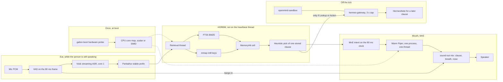

# R4 — HORBM faster than real time on CPU, and how it fits what exists

Perpetual Open MIT License. (c) 2026 Galion Labs.

| Field | Value |
|---|---|
| Swarm | HORBM, agent R4 of 4 |
| Written | 2026-11-18 (research session). No benchmark, no measurement, no download, no paid API, no voice audio. |
| Status | **Research note.** It does not change `LOCKS.toml`, does not train, and does not override the owner ruling of 2026-11-04 20:45 CET. Where this note disagrees with that ruling, the ruling wins until the owner says otherwise. The disagreement is written in §11. |
| Repo read | `galion-one-voice` at `fb020a5` (branch `main` fetched 2026-11-18). |
| Other tree read | `galion-studio/obsidian-open-mind` `main`, via the GitHub contents API on 2026-11-18. Not cloned. Not vendored. |

## How to read a number

Every number in this note has one tag. A tag without a source is not a result.

| Tag | Meaning |
|---|---|
| **[D]** | A design constant already in a named file. |
| **[M]** | A measurement already written in this repo. This session did not repeat it. |
| **[C]** | A published source, named in §14, with who said it and when. |
| **[R]** | Read from `obsidian-open-mind` `main` on 2026-11-18. A description of code, not a timing. |
| **[T]** | A target this note proposes. Not measured. A later eval (§12) is what would replace it. |

"Faster than real time" means two clocks, and they are not the same number.

1. **Throughput.** A stage is faster than real time when it finishes a slice of speech in less wall time than that slice lasts. The ear and the mouth must stay ahead of the 80 ms frame, or the frame pauses.
2. **Turn gap.** The work still left when the person stops speaking must finish inside the gap a person expects before the other voice starts. That gap is the one that feels like conversation.

The 80 ms heartbeat is already faster than its frame, by a wide margin, on the build that measured it. The turn gap is not. That is the whole problem.

---

## 1. What HORBM keeps from XiaoIce, and what it drops

XiaoIce, as Zhou, Gao, Li and Shum describe it (arXiv 1812.08989, 21 December 2018; journal version *Computational Linguistics* 46(1), March 2020), is a social chatbot, not a full-duplex audio engine. Their abstract says the system balances intelligent quotient (IQ) and emotional quotient (EQ), casts conversation as a hierarchical decision, and joins retrieval-based and generation-based replies. They report a deployment that, in their words, had reached on the order of 660 million users since the 2014 launch. That figure is their claim about their system. This note does not re-check it.

The part worth keeping is the shape of the decision, not the cloud corpus and not the product score.

| XiaoIce, as that paper describes it | HORBM on this stack |
|---|---|
| A manager decides whether to answer, which skill, then which reply. | The conductor already sketched in the Symphony plan decides the floor. `galion-sideband` already types `Chat`, `Lookup`, and `Action` tiers. **[D]** `crates/galion-sideband/src/lib.rs` |
| Core Chat retrieves a reply from paired text and ranks it. Generation fills gaps. | The hot brain **retrieves a stored clause**. It does not decode tokens on the tick. If nothing is stored, it says so. Generation is not the voice. |
| EQ is a model of the user's feeling, used to pick a warmer reply. | EQ stays the feeling band and the persona prose. Galion One and Galion Research both forbid a scripted empathy line. **[D]** `docs/galion-voice-v2/personas/GALION-ONE.md`, `GALION-RESEARCH.md` |
| Skills (weather, image, and the rest) sit beside Core Chat. | Skills are Hermes tools, inside `openmind-sandbox`, off the 80 ms tick, under the 3 s side-band cap. **[D]** `RETRIEVAL_CAP` in `galion-sideband`. **[R]** `crates/openmind-sandbox` |
| Their reported product score is conversation-turns per session. | That score is an engagement metric. Galion's presence harness forbids session length, retention, and stickiness. **[D]** `docs/research/galion-voice-v2/domains/08-evaluation.md` (Maciej Grajczyk, 2026-11-03). HORBM does not adopt CPS. |

HORBM, for this note, means: **Heuristic Open Retrieval Brain Model**. A non-LLM brain. CPU first. Rust first. Knowledge stored as very short clauses with a compressed key, so a lookup is a scan of kilobytes, not a forward pass. It learns only from past turns the person agreed to keep.

It is not a new runtime, and it is not Moshi. Moshi and PersonaPlex stay references for full duplex. They are not the CPU path. See §4.

### Conflict with the 2026-11-04 ruling

The ruling printed at the top of `docs/galion-voice-v2/sprint-v2/research/SYMPHONY-STACK-V2-PLAN.md` and `docs/galion-voice-v2/PERSONAPLEX-REANCHOR.md` (Maciej Grajczyk, 2026-11-04 20:45 CET) says the reasoning sector is the in-house S0 student, about 0.5B parameters, `.gq`, W8A8, on `galion-tensor`, with `CannedLlm` until weights exist. No Qwen, no Groq, no cloud LLM.

This note does not delete that ruling. It says the hot path cannot wait on a token loop if the turn gap is the goal, and the numbers already in the tree are why (§5, bottleneck 1). The proposed split is:

- **Hot path (Galion One, every tick-adjacent turn):** HORBM retrieval. No student decode.
- **Cold path (Galion Research, side band):** `hermes-rs` / `hermes-gateway`, already off the tick, 3 s cap.
- **S0:** optional later, and only as a reranker that has been shown to finish inside the leftover budget. Until that measurement exists, S0 is not on the voice path. `CannedLlm` remains the honest stand-in wherever a generative reply is still called.

That split is an owner decision. It is open question Q1.

---

## 2. What already exists

Read 2026-11-18. "In tree" means `galion-one-voice`. "Open Mind" means `obsidian-open-mind` `main`.

| Piece | Where | What it is for HORBM |
|---|---|---|
| 80 ms clock, full duplex bands `you` / `me` / `feeling`, frame compute budget p95 60 ms, barge-in 200 ms, onset p50 max 300 ms, realtime headroom 2.0 | `LOCKS.toml` `[clock]`, `[bands]`, `[gates]`, `[probe]`, locked 2026-11-02, Maciej Grajczyk | The deadlines. Not negotiable in this note. **[D]** |
| Heartbeat that does not block or allocate | `crates/galion-heartbeat`. Symphony plan cites p99 3.2 µs per tick on the build host | The clock is not the bottleneck. **[M]** as cited by `SYMPHONY-STACK-V2-PLAN.md` (written 2026-11-03) from `docs/galion-voice-v2/symphony/SELF-EVAL.md` |
| MnE V2 | `tools/symphony/mne-contract` (80 ms intent and read-back), `feeling`, `lungs`, `mouth`, `nose`, `sound-out`, `listen-back`. Integrator `tools/symphony/mne` (README: layers still "waiting") | The body. HORBM is the inner life that posts intent. MnE does not think. |
| Piper, interim mouth | `LOCKS.toml` `[formats.exceptions.a21_piper]`, sunset 2027-02-01, out of process, CPU. Adapter `tools/symphony/sound-out` (`PiperBackend::real_if_present` does not download). Prior warm TTFA in §5 | The sound-out until a native `.gq` voice exists. |
| Moshi | `tools/symphony/sound-out/src/moshi.rs`: stub, `realtime_on_cpu: false`, "does not look for weights". Comment: the research note says it needs a GPU | Must stay off the CPU realtime path. |
| PersonaPlex-like duplex | `LOCKS` `duplex = "full"`. Plan: `docs/galion-voice-v2/PERSONAPLEX-REANCHOR.md` (2026-11-04), decision D1-A recommended: model decides when, Piper speaks. Open Mind relay: `crates/persona-plex-relay` README, read 2026-11-18: **scaffold, opens no socket, max one session in the design** | Our duplex is the cascade plus conductor until a CPU-real path exists. The GPU relay is not that path. |
| Hardware detect | **No crate named `galion-hw`** on `galion-one-voice` `main` or in the Open Mind crate list read 2026-11-18. The probe that exists is `crates/galion-boot/src/hardware.rs` (comment: "B54: hardware probe") plus `crates/openmind-survival/src/degrade.rs` (B24). SIMD detect is `crates/galion-tensor/src/features.rs` | See §7. The name in the task does not match a crate. The behaviour does. |
| Galion Research engine | Open Mind `crates/hermes-rs`, `crates/hermes-gateway`. Voice side types only: `crates/galion-sideband`, seam `docs/galion-voice-v2/OPENMIND-NERVE-CORTEX.md` (read of Open Mind at `7ba85b60` on 2026-11-03; this note re-read the crate roots on 2026-11-18) | Cortex. Never on the tick. |
| Memory | Open Mind `crates/openmind-memory`: "SQLite FTS5 BM25 recall, offline, std HTTP" **[R]** Cargo.toml description. Voice does not link it. | The store HORBM should read in-process, not over HTTP, on the hot path. |
| Consent | `LOCKS.toml` `[consent]`: `sense`, `adapt`, `remember`, `share`, default deny. Withdrawal wipes RAM history. | The learning gate. §9. |
| Sandbox | Open Mind `crates/openmind-sandbox`: rlimits, namespaces, Landlock, optional cgroup, no seccomp, "not a hard security boundary" **[R]** `src/lib.rs` header | Tool runs only. Not the retrieval scan. |
| Universal CPU rule | Open Mind `UNIVERSAL-CPU.md`, added 2026-10-18 21:02 CEST: portable Rust, no `target-cpu=native`, SIMD only behind `cfg` with a scalar fallback, no tokio "full" | HORBM index SIMD must follow this, the way `galion-tensor` already does. |

---

## 3. Architecture

HORBM sits where a reply model would sit. It does not sit inside `Heartbeat::step`. The step only reads the latest control cell. That rule is already in the heartbeat crate and in the Symphony plan (2026-11-03).

The person's speech and the machine's speech overlap in time. That is full duplex, as `LOCKS.toml` `[bands] duplex = "full"` already requires. The overlap is done by the conductor (duck, pause, yield), not by a 7B speech model. MnE's nose track is the place for a wordless backchannel. The brain does not have to speak a word to show it is listening.

Galion One is the persona card on this path. Galion Research is the side box. They share the store. They do not share the tick. §8.

---

## 4. Full-duplex latency budget

### 4.1 Deadlines that already exist

| Deadline | Value | Who set it | When |
|---|---|---|---|
| Frame | 80 ms, 12.5 Hz, not configurable | `LOCKS.toml` `[clock]`, Maciej Grajczyk | locked 2026-11-02 **[D]** |
| Compute inside a frame, p95 | 60 ms | same, `frame_budget_p95_ms` | 2026-11-02 **[D]** |
| Barge-in, user onset to silence | 200 ms | `barge_in_max_ms` | 2026-11-02 **[D]** |
| Onset of our speech, p50 | ≤ 300 ms | `onset_p50_max_ms`, "hard blocking gate" | 2026-11-02 **[D]** |
| Affect to audible cue | 160 ms | `affect_to_voice_max_ms` | 2026-11-02 **[D]** |
| Headroom if a neural step is ever used | 2.0 × 12.5 Hz = 25 steps/s | `[probe] realtime_headroom` | 2026-11-02 **[D]** |
| Human turn gap, modal | 200 ms or less, ten languages | Stivers et al., PNAS | 2009 **[C]** |
| One-way delay, planning | 0–150 ms comfortable for most uses; above 400 ms unacceptable for general planning of highly interactive tasks | ITU-T G.114 | May 2003 **[C]** |
| Phone-agent market band | about 1.3–1.9 s p50 time-to-first-audio over PSTN | domain 08, citing openbenchmarks 2026-08-01 | note dated 2026-11-03 **[C]** as quoted there |
| Moshi theoretical / practical | 160 ms theoretical (80 ms frame + 80 ms acoustic delay); "as low as 200 ms" on an L4 GPU | Kyutai Moshi README, as quoted by `PERSONAPLEX-REANCHOR.md` and by Open Mind `docs/persona-plex-v2-design.md` (draft 2026-10-18) | paper arXiv 2410.00037, 2024 **[C]** |
| PersonaPlex Full-Duplex-Bench | turn-taking 0.170 s, interruption 0.240 s, on GPU (A100 in the re-anchor's reading of the card) | NVIDIA card `nvidia/personaplex-7b-v1`, paper arXiv 2602.06053 | the re-anchor says these were **not** measured here, 2026-11-04 **[C]** |

Moshi's 200 ms and PersonaPlex's 170 ms are GPU figures. `moshi.rs` sets `realtime_on_cpu: false`. The re-anchor's arithmetic (2026-11-04) says PersonaPlex-7B does not fit the 8-core, 16 GB, no-GPU box. HORBM does not try to beat those GPU figures by running those models on CPU. It tries to land the **cascade** inside the lock, by having nothing left to compute at end of speech.

### 4.2 Prior cascade, already measured, not re-run

From `docs/galion-voice-v2/sprint-v2/SPRINT-REPORT.md` §3. Hardware named there: Intel Xeon, 8 vCPU, AVX2 and AVX-512F, 16 GB, kernel 6.12. Piper `en_US-ljspeech-medium`, persistent process, n=24. The loop used Vosk, then a cloud LLM (OpenRouter llama-3.1-8b via Groq), then Piper. The 2026-11-04 ruling supersedes that LLM. The row is kept because it shows where time went.

| Stage, from end of speech | p50 | p95 |
|---|---|---|
| Endpoint (160 ms hang) | 130 ms | 140 ms |
| ASR final | 154 ms | 166 ms |
| LLM time-to-first-token, alone | 285 ms | 498 ms |
| First clause | 517 ms | 724 ms |
| Piper inside that loop | 71 ms | 182 ms |
| First content audio | 608 ms | 775 ms |
| Cached backchannel audio | 186 ms | 213 ms |

Warm Piper alone, same section: 1 word p50/p95 25.9 / 35.2 ms; 2 words 33.2 / 43.3; 4 words 42.3 / 60.2; 8 words 74.2 / 93.5. One core was faster than eight (4-word p50: 1 core 37.2 ms, 8 cores 45 ms). Cold spawn to first PCM: 334.3 / 440.3 ms. The report's own verdict: 80 ms was met for warm Piper on clauses of about eight words or fewer; the end-to-end loop was not; the bottleneck was LLM time-to-first-token plus the endpoint hang.

A later line in `docs/galion-voice-v2/sprint-v2/research/SYMPHONY-STACK-V2-PLAN.md` §5.2, same authoring session 2026-11-03, splits the same loop as endpoint 130.2, ASR final 19.9, gap 67.9, LLM 284.7, first clause 20.6, TTS 71.3. The two tables do not use the same clock for "ASR final". This note treats the sprint report as the loop measurement and the 19.9 ms figure as the finalise step once the hang is excluded. It does not average them.

Under load average 14–17, the same plan cites Piper at 128 ms for one word (`latency-240/01-data/affinity-loaded.ndjson`). Isolation is part of the budget. A number taken on a busy box is not the gate.

Clone lane, same report §4 and the plan §5.3: Chatterbox Nano on CPU is about real-time or slower (report: about 2.0–2.8 s for about 4.5 s of audio, RTF about 0.5, 8 threads; live endpoint to first cloned clause measured in seconds). It cannot sit on the content path. Owner ruling in the sprint report (2026-11, "19:27"): Piper stays the TTS engine; the Python Chatterbox worker is benchmark-only. This note does not use donor audio and does not reopen that lane.

### 4.3 R4 targets (not measured)

End of speech means the eager end-of-turn, not the late final flag. The stable prefix is defined as the Symphony plan defines it: unchanged for two ticks, 160 ms (`SYMPHONY-STACK-V2-PLAN.md` §4.4, citing domain 04). Work done during those 160 ms, and during the speech before them, is not on the turn-gap clock.

| Stage | When it runs | Prior evidence | R4 target **[T]** | Fits the lock? |
|---|---|---|---|---|
| VAD + frame bookkeeping | every 80 ms, inside `step` | p99 3.2 µs cited above **[M]** | stay under 60 ms p95 compute **[D]** | yes, already |
| ASR partial | while the person speaks, streaming | Vosk is the in-tree ASR (`crates/galion-asr-vosk`) | a partial every frame; no extra wait | yes if it stays on its own core |
| Retrieval | on each growth of the stable prefix, **during speech** | not measured on this box. Plan's G-MEM-1 is p95 ≤ 5 ms at 100k items **[T]** inherited | p95 ≤ 5 ms warm; cold page-in is hidden because the person is still talking | yes, off the tick |
| Eager end-of-turn | one frame of hang after the stable prefix, instead of 160 ms | prior hang p50 130 ms **[M]** | 80 ms **[T]** | inside `onset_p50_max_ms` 300 |
| Brain at end of speech, prefix hit | the clause is already chosen | cloud LLM p50 285 ms **[M]**, superseded | ≤ 1 ms to read the cell **[T]** | yes |
| Brain at end of speech, miss | one warm scan | G-MEM-1 | ≤ 5 ms, then a stored "I don't have that" clause **[T]** | yes |
| First clause text | no token decode | cloud first-clause row is hundreds of ms because it includes the LLM **[M]** | a stored clause of at most two spoken words, chosen by the heuristic **[T]** | yes |
| Piper first PCM | after the clause is handed over | warm 1-word p95 35.2 ms; in-loop p50 71 ms **[M]** | ≤ 35 ms p95 for a 1-word clause, warm process, one thread **[T]** | yes on an isolated core; no if the box is loaded (128 ms cited above) |
| Cached wordless reaction | parallel with the clause | cached backchannel p50 186 ms inside the cloud loop **[M]** | start within one frame of eager end-of-turn, target ≤ 120 ms to first PCM **[T]** | aims inside the 200 ms human gap **[C]** |
| First **content** audio | sum of what is left at end of speech | 608 / 775 ms **[M]** | p50 ≤ 200 ms, p95 ≤ 240 ms **[T]** | tighter than the lock's 300 ms onset; looser than a serial fantasy |
| Barge-in to silence | while we are speaking | lock 200 ms **[D]**; live call cited by the plan at about 200 ms **[M]** | ≤ 200 ms | the lock |
| Hermes | only on Lookup / Action | cap 3 s **[D]** | filler or local clause inside the content budget; the researched sentence arrives later or not at all | off the tick |
| Throughput, mouth | while audio plays | warm TTFA for ≤ 8 words met an 80 ms bar in the sprint report **[M]** | RTF &lt; 1 on the pinned core, short clause **[T]** | Piper already showed this when warm and alone |
| Throughput, ear | while audio arrives | not remeasured | each 80 ms of PCM is consumed before the next frame deadline **[T]** | this is the ear's "faster than real time" |

A serial sum of the targets that still run after end of speech (80 ms hang + 1 ms cell + 35 ms Piper) is about 116 ms. That sum is arithmetic on targets, not a predicted p50. p95 will move with endpoint mistakes and with whoever else is on the cores. The honest gate is the table, measured later on an isolated box, n≥24, the same shape as the sprint report. This session did not run it.

Domain 04 (2026-11-03) aimed at a phone mouth-to-ear of p50 ≤ 900 ms. That target assumed an LLM on the path. HORBM's local target is the turn gap, not the phone-market band. Network hops are out of this budget. The budget is machine-local: end of speech on this CPU to first PCM on this CPU.

### 4.4 Why the sum can be small

Streaming pipelines overlap. Domain 04 says a blocking pipeline adds the stages, and a streaming pipeline approaches the slowest stage (citing LiveKit's sequential-pipeline note). HORBM pushes the slow stages into the time the person is still speaking:

1. ASR partials are already the contract (`PartialAsr` in the bus, Symphony plan §2.2).
2. Retrieval runs on the stable prefix, not on the final transcript.
3. The heuristic writes one clause into a cell. End of speech reads the cell.
4. Piper is already warm, so the only new work is one short clause.
5. A wordless reaction can start from a cached clip while Piper makes the clause. The sprint report already showed a cached backchannel ahead of content. HORBM keeps that, and removes the LLM from both clocks.

If the person resumes, the cell is dropped and the epoch bumps. The Symphony plan already asks for that rollback. `KvRing` rollback matters only if S0 is on the path. HORBM's rollback is "discard the cell". That is the point of not decoding.

---

## 5. Streaming retrieval while the person is still speaking

The scan is allowed to be wrong for a few frames. It is not allowed to be late.

On each `PartialAsr` whose stable prefix grew:

1. The retrieval thread builds a query from the new tail only.
2. It runs FTS5 BM25 (the index `openmind-memory` already speaks) and an int8 key scan (the arena in §6).
3. It fuses a handful of hits. The Symphony plan's cap is 4 hits in the `MemoryHit` cell. This note keeps that cap.
4. It publishes the cell. Readers take a snapshot. They do not lock the index.
5. The heuristic picks one clause, or the honest miss clause, and parks it.

Nothing in that list runs inside `Heartbeat::step`. Nothing in that list calls Hermes. Hermes starts only when the intent tier is `Lookup` or `Action`, and the voice keeps the parked clause ("I can look that up") so the 3 s cap cannot freeze the mouth. That is the same pattern the Symphony plan attributes to MoshiRAG (Kyutai, blog 2026-04-30, as cited there).

Consent is checked before a hit is allowed into the cell. A row written without `remember` is not on disk (§9). A row with `share` denied is invisible to the other persona. Default is deny. **[D]** `LOCKS.toml` `[consent]`.

The miss clause is part of the index, not a generative apology. Galion Research's persona file already fixes the words for timeout, unreachable, and not-found. **[D]** `GALION-RESEARCH.md`.

---

## 6. Rust threads, SIMD, mmap, quantisation, cache

### 6.1 Threads, not an async runtime on the audio clock

`hermes-rs` is explicit: "Portable Rust only, std threads, no async runtime, no TLS stack" (`src/lib.rs`, read 2026-11-18). `UNIVERSAL-CPU.md` (2026-10-18) says no tokio "full". The heartbeat must not await.

HORBM follows that.

| Thread | Blocks? | Talks to the clock how |
|---|---|---|
| Audio / heartbeat | never, and does not allocate | reads the latest control cell |
| ASR | yes, on its core | posts `PartialAsr` |
| Retrieval | yes, on its core | posts `MemoryHit` |
| Piper writer | yes, on the pipe to the warm process | posts PCM frames |
| Hermes | yes, up to 3 s | posts `HermesNote` for a **later** clause |
| Learn | only after the session, and only if consent allows | no bus traffic during the call |

Bounded channels, drop-stale by epoch, the rule already in `docs/galion-voice-v2/IPC.md` as cited by the Symphony plan. Async I/O is acceptable inside the Hermes process, because that process is not the 80 ms clock. It is not acceptable on the heartbeat thread. `hermes-gateway` today is a std binary (`crates/hermes-gateway/src/main.rs`). Leave it that way.

Core map, live call, from the Symphony plan's table, with the LLM cores released:

| Role | Cores on an 8-core box **[T]** | On a 4-core box **[T]** |
|---|---|---|
| Heartbeat, VAD, conductor | 1, real-time priority | shared with ASR |
| ASR | 1 | shared with heartbeat |
| Retrieval | 1 | 1 |
| Piper | 1, and only one thread inside Piper | 1 |
| Hermes, sandbox, learn | the rest, idle during a pure chat turn | only when no call is in the gap |
| S0 decode | none on the hot path | none |

Piper's own measurement says one thread is the fast case (§4.2). Do not give it eight.

### 6.2 SIMD

`galion-tensor` already has the pattern HORBM should copy (`src/features.rs`, `src/simd.rs`):

- Scalar is the source of truth.
- AVX2, AVX-512, and NEON are cargo features, off by default, and a runtime check (`is_x86_feature_detected`, `is_aarch64_feature_detected`).
- `GALION_SIMD=scalar|avx2|neon` caps the level. The file's own comment says the cap exists to avoid AVX-512 frequency throttling on some VPS CPUs.
- int8 dot is bit-exact against scalar. f32 dot has a documented tolerance.

The index scan is an int8 dot plus a compare. It should call that kernel, not a new one, and not a forbidden runtime. `LOCKS.toml` `[formats] forbidden_runtimes` lists candle, ort, tract, burn, llama, ggml. The Piper ORT process is a named exception, out of tree. The scan stays inside `galion-tensor`'s own kernels.

`hermes-rs` pins `sha2` to `force-soft-compact` so the gateway binary stays small (the Cargo.toml comment, dated in-file 2026-11-14, says the binary sat at 2,086,816 bytes of a 2,097,152 byte cap). That no-SIMD choice is about binary size for the gateway. It is the wrong choice for the scan. The two crates do not have to match. Open question Q4.

### 6.3 Memory-map and prefault

`galion-tensor`'s `.gq` reader already maps a file on Unix and can prefault it (`gq.rs`: `Prefault::{None, WillNeed, Populate, Touch}`). The comment there says a page fault inside an 80 ms frame misses the deadline. The same rule applies to the knowledge file.

HORBM's cold file is a read-only pack:

- a SQLite file for FTS5 text (the engine `openmind-memory` already uses, bundled amalgamation, no system libsqlite);
- beside it, an int8 key arena, 64-byte aligned, mapped with the same `Prefault::Populate` or `Touch` at boot, never on the first live partial.

This note did not read `openmind-memory`'s query source, so it does not claim that crate sets `mmap_size`. SQLite's own documentation describes `PRAGMA mmap_size` as the switch that lets the pager use `mmap` (sqlite.org, "Memory-Mapped I/O"). Turning that on for the FTS file is a later change, measured when an eval is allowed. It is not turned on here.

The hot path never opens the pack. Boot maps it. The retrieval thread only reads.

### 6.4 Quantisation and bytes per clause

The key is a short int8 vector, not a float embedding model on the tick. A static table, if one is ever used, is itself a `.gq` tensor so the same SIMD dot runs it. The Symphony plan's Q3 asked whether a static Model2Vec table was acceptable. This note does not pick a model. It picks the layout.

Proposed record, so the working set is countable **[T]**, not measured:

| Field | Bytes | Why |
|---|---|---|
| clause id | 8 | points at the text in SQLite |
| int8 key | 32 | 32-wide dot fits one AVX-512 register, two AVX2 registers, eight NEON registers |
| consent bits + persona scope | 4 | checked before the hit is published |
| source pointer | 8 | the truth rule: a clause remembers where it came from |
| pad to 64 | 12 | one x86 cache line. Intel's optimisation manuals treat 64 bytes as the line size **[C]** |

At that width, 16 clauses are 1 KB. A 100,000-clause arena is 6.4 MB of keys, which is the size the Symphony plan already called a warm RAM tier (their estimate was larger, because they stored f32). The text stays in SQLite. The scan touches keys first and text only for the four hits.

This density is a layout, not a quality claim. A 32-byte key will miss paraphrases. BM25 on the words is the recall path. The key is the tie-break and the cache-friendly filter. A learned reranker is forbidden on the tick until it has a measured budget. That is bottleneck 1.

### 6.5 Cache layout

Structure of arrays, not an array of fat structs. Keys in one mapped region, consent bits in a parallel bitset so a denied row is skipped before the dot. Four hits copied into a stack array. No `String` allocation on the scan. The persona card (a few hundred tokens of prose, the Symphony plan budgets ≤ 300) is hot, parsed once at session start, and is not re-read per partial.

Do not pin the arena to a NUMA node in v1. `galion-boot` does not report NUMA today (`hardware.rs` reports processors, arch, RAM, GPU). A one-socket VPS is the default box in the voice docs.

---

## 7. Hardware detect, CPU first, GPU when present

There is no crate named `galion-hw`. GitHub repository search for that name under `galion-studio` returned no repository on 2026-11-18, and the Open Mind crate directory has no `galion-hw`. The probe the task is pointing at is this:

`galion-boot` `hardware.rs` (file comment: port of `hardware.sh`, work item B54) reads `/proc/meminfo`, `available_parallelism`, `nvidia-smi` if it returns a row, otherwise a DRM card under `/sys/class/drm`. It then calls `openmind_survival::degrade::profile`.

`degrade.rs` (file comment: B24, first match wins), thresholds `MIN_GPU_FREE_MIB = 8192`, `MIN_RAM_MIB = 8192`:

| Condition | `llm` value | Weights | Line, as written in the file |
|---|---|---|---|
| GPU present, ≥ 8192 MiB free, RAM ≥ 8192 | `local-gpu` | on | "Obsidian has room for local weights." |
| WAN down, LAN up | `lan` | off | "Internet is down. Hermes uses the LAN model." |
| WAN down, LAN down | `cpu-light` | off | "No network. CPU-light: probes and desk only, work is queued." |
| GPU present but the first rule missed | `api` | off | "A card is here, but not enough free memory. Hermes stays on the laptop model." |
| otherwise, including a CPU with WAN up | `api` | off | "CPU only. Hermes stays on the laptop model. Weights stay off." |

`mouth` is true only when RAM ≥ 8192 MiB. A 2 GB machine is marked unable to run the voice worker. That threshold is in the file. This note does not change it.

Two mismatches with HORBM, both owner-visible:

1. **CPU-only currently selects `api`.** The 2026-11-04 ruling forbids a cloud LLM on the voice path. HORBM's CPU profile is local retrieval, not `Llm::Api`. The boot probe can keep detecting the machine. The voice path must not follow the `api` line.
2. **A GPU must not move the voice clock onto Moshi or PersonaPlex.** `local-gpu` means "weights fit", not "full duplex speech model". The PersonaPlex design (2026-10-18) says the GPU host is not provisioned, the relay opens no socket, and the PyTorch Moshi build wants a large GPU (the design quotes the Moshi README: 24 GB for the unquantised PyTorch build). Even when `galion-boot` reports a card, the CPU cascade remains the voice. A GPU path is an optional extra process, off by default, and only after a licence and a measurement this note does not do.

`galion-tensor` `features.rs` is the second detector: scalar unless the binary was built with the feature and the CPU has the flag. HORBM uses that for the key scan. It does not fork a new detect.

`cgroup-detect` (Open Mind) only reports whether a per-run cgroup is possible. Its Cargo.toml says it never creates a cgroup. Core pinning for the latency gate is an operator step, not something this note turns on.

---

## 8. Plugging into Galion One and Galion Research

### 8.1 Galion One, the voice

Galion One is the product voice (`docs/galion-voice-v2/personas/GALION-ONE.md`). The file's own rules that bind HORBM:

- One or two sentences. The mouth flushes a clause at punctuation or about eight words.
- "You may not pretend yesterday's call is in your pocket." Without `remember`, there is no yesterday.
- Withdrawal wipes RAM history. After that, the voice does not recall it.
- No cloud. If the path is down, say so.

On the bus, Galion One is a persona slot: a card, a prosody bias, a Piper voice, a set of cached wordless clips. Switching slot swaps those. It does not start a second brain. The Symphony plan's warning still holds: two heavy models on one 8-core box missed real time (they measured clone RTF, not HORBM). HORBM is one index, many cards.

MnE consumes intent and returns read-back on the same 80 ms clock (`tools/symphony/mne-contract`). HORBM posts intent (the clause, the pause, the nose burst). It does not write PCM. `sound-out` owns PCM. Piper is the interim backend. The Moshi adapter stays a stub.

### 8.2 Galion Research, the workspace

Galion Research is a voice and a workspace (`GALION-RESEARCH.md`). The voice is not the gateway. The file says: keep speaking from local knowledge while a lookup is in flight; the side band is not on the 80 ms heartbeat.

The gateway that exists:

| Crate | What the file says | HORBM use |
|---|---|---|
| `hermes-rs` | Rust port of the parts of Nous Research `hermes-agent` 0.21.4 that Galion uses. Sessions, cron, MCP, spend, std threads. HTTPS via the system `curl`, key on stdin, not argv. `redact()` before text leaves the process. | The analytical agent. Called only for `Lookup` and `Action`. |
| `hermes-gateway` | "the Rust Hermes API server binary". Default features `sqlite` and `coding`. Coding tools are compiled in and **off unless `HERMES_RS_CODING_WORKTREE` is set**. | Loopback only, same as the voice side-band's existing assumption (`127.0.0.1`, 3 s). |
| `openmind-memory` | FTS5 BM25, std HTTP, rusqlite bundled. | Research reads it. The voice hot path should embed the same schema in-process so a lookup of a personal fact does not pay an HTTP round trip. The HTTP server stays for the workspace. |
| `openmind-sandbox` | One command, rlimits, cleared env, namespaces, Landlock, optional cgroup. | Any tool the research brain runs. Retrieval of a clause is not a sandbox exec. |
| `openmind-persona` | linked by `hermes-rs` | Persona text for the research voice. Not a second index. |

`galion-sideband` already has the wire: `ToHermes` / `FromHermes`, `NoKnowledge { Timeout, Unreachable, NotFound, Denied }`, `ActionTier` with money always refused by `voice_may_request`. HORBM does not invent a new wire. A `Denied` from consent is a spoken limit, not a retry.

Nerve events stay free of PCM and transcripts. `OPENMIND-NERVE-CORTEX.md` §4 already says that. A learning log is not a nerve line (§9).

`persona-plex-relay` is not Galion Research and not HORBM. It is a scaffold toward a GPU speech model. Full duplex on CPU does not go through it.

---

## 9. Learning from past turns, without silent logging

The loop is offline. The call never waits for it.

**During the call.** A RAM ring holds the turn text and the clause id that was spoken. No audio. Domain 07 (Maciej Grajczyk, 2026-11-03) already asks for audio in RAM only, wiped at end of turn, and logs that store lengths and latencies, not PCM and not the transcript. HORBM keeps that. The ring is wiped on session end if `remember` is denied, and immediately on withdrawal. `LOCKS.toml`: `withdraw_wipes_ram_history = true`, `default = "deny"`.

**After the call, and only then.** A learn pass may write a clause into the pack if all of the following are true:

1. `remember` was granted before the turn, and is still granted.
2. A separate learn consent was granted. `remember` means "you may recall this". It does not mean "you may train on this". Domain 07 says retention and training are separate opt-ins, and EDPB Guidelines 02/2021 (cited there) treat recordings, transcripts, and request history as personal data, with anything beyond the requested service needing its own consent. This note does not treat `adapt` as the learn bit. `adapt` is already the bit Rika requires, together with `sense` (`LOCKS.toml`). Overloading it would mix affect-following with corpus growth. Open question Q2.
3. The clause stores its source: session, turn id, time, and the consent record version. The truth rule is the same one this note uses. A learned clause with no source is not written.
4. The write is a new pack, built beside the mapped file, then swapped. The live map is read-only. There is no writer on the retrieval thread.
5. The sandbox is not required for the swap (it is a file rename by the voice process). Any tool that extracts the clause by running a program goes through `openmind-sandbox`.
6. Withdrawal deletes the pack rows for that person and the consent record. GDPR Art. 17 is the legal frame domain 07 and the PersonaPlex design both point at (Regulation (EU) 2016/679). This note is not legal advice. Croatia's authority is AZOP, as those docs already say.

**What is never logged.** PCM. A voiceprint. A donor clip. Nerve lines that contain the words. Prompts to a cloud model. The 2026-11-04 ruling already forbids the cloud model. CC0 donor audio is out of this design entirely: the learn loop has no audio input.

**What "learns" means.** Heuristic weights on the ranker: a consented "that was wrong" demotes a clause; a consented correction inserts a new clause with the correction as source. No gradient, no student update, no engagement reward. Domain 08 and the re-anchor both forbid rewards for session length or for steering the person's affect.

---

## 10. Ranked bottlenecks and the fix that fits the tree

Ranked by how much they blow the turn gap, using the prior measurements where they exist and the architecture where they do not. Fixes are design, not patches. Nothing here was timed in this session.

| Rank | Bottleneck | Evidence | Fix that fits what exists |
|---|---|---|---|
| 1 | A generative decode on the hot path | Sprint report: LLM time-to-first-token p50 285 ms, first content audio 608 ms. Re-anchor: even a small local model is bandwidth-bound; PersonaPlex-7B does not fit. Ruling puts S0 here, and S0 weights are not in the tree. | HORBM retrieval replaces decode on the tick. S0 stays off until a later measurement puts a reranker inside the leftover budget. `CannedLlm` only where a caller still expects a generative API. |
| 2 | Waiting until the final ASR flag | Endpoint p50 130 ms with a 160 ms hang. Domain 04: the interim transcript should start the next stage. | Eager end-of-turn on a stable prefix (two ticks). Retrieval already finished during speech. The final flag confirms or rolls the epoch back. |
| 3 | Piper cold, or Piper sharing a loaded box | Cold spawn p50 334 ms. Warm 1-word p50 25.9 ms. Loaded box, plan's citation, 128 ms for one word. One core beats eight. | One warm process for the active voice, one thread, pinned, started at call setup. Never spawn per clause. Clause ≤ 2 words for the first PCM. Isolation is part of the gate, or the gate is noise. |
| 4 | Anything neural that clones a voice on the live path | Report and plan: clone lane is seconds, or RTF around 0.5, and slower when two workers run. Lock: Chatterbox is out of process and sunset 2027-02-01. | Not on the content path. Wordless clips, if any, are built ahead of the call and are not donor audio. This research does not make them. |
| 5 | Moshi or PersonaPlex treated as the CPU engine | `moshi.rs` `realtime_on_cpu: false`. Relay README: scaffold, no socket. Design: GPU not provisioned. | CPU duplex is conductor + Piper + HORBM. The relay stays a remote option with `max_sessions = 1` and the CPU path as the fallback when `upstream.enabled` is false (the design's shipped default). |
| 6 | The gap between processes | Plan's split of the old loop includes a 67.9 ms gap. Piper must stay out of process (`a21_piper` `in_process = false`). Hermes over HTTP would add another one. | Brain, ASR, and the cell are in-process channels. Piper stays a warm pipe, one write per clause. Research HTTP is off the tick. Personal-fact reads do not go through `openmind-memory`'s HTTP server. |
| 7 | A cold index on the first partial | Not measured. `.gq` comments already say a fault inside the frame misses the deadline. | Map and prefault at boot (`Prefault::Populate` or `Touch`). The first partial hits resident pages. |
| 8 | A fat struct scan, scalar, on the wrong core | No measurement. The layout in §6 is the reason to care: a 32-byte key is one vector; a fat row is several cache lines and a branch. | SoA int8 keys, 64-byte alignment, `galion-tensor` int8 dot, scalar fallback. One retrieval core. |
| 9 | An async runtime or a sandbox exec on the audio path | `hermes-rs` refuses an async runtime. `openmind-sandbox` is a process with namespaces. Either one inside `step` breaks the "never blocks" rule. | std threads. Sandbox only for research tools, after the clause has already been spoken. |
| 10 | Learning or logging on the hot path | Domain 07: transcripts in logs are a leak. A writer on the mapped pack faults and locks. | RAM ring only. Pack swap after the call, consent-gated, no audio. Nerve lines stay free of words. |
| 11 | The boot profile sending a CPU box to an API model | `degrade.rs` rule `cpu-only` → `Llm::Api`. Conflicts with the 2026-11-04 ruling for the voice. | Voice ignores `api` and `local-gpu` for the mouth's brain. CPU means HORBM. GPU present does not switch the clock. |
| 12 | Box contention with no cgroup | Plan §7: other agents pushed load average to 7–17 and Piper slowed. `cgroup-detect` will not create a cgroup by itself. | The eval (§12) runs on an isolated box. If delegation is absent, record that, and do not pretend p95 is the algorithm. |

---

## 11. Phased build

No dates. Each phase ends when its gate is written down beside a command and a commit. This note is phase 0. It does not start phase 1.

The 2026-11-04 ruling stays in force through every phase until Q1 is answered. Phases 1–3 do not put a third-party model on the path and do not download weights.

| Phase | Build | Gate, later, not now | Depends on |
|---|---|---|---|
| 0 | This note. | The owner can see the conflict with S0 and the conflict with `degrade.rs`. | — |
| 1 | Stamps only: the domain 04 timestamp list (`t_vad_silence_start` through `t_tts_first_pcm`) on the existing cascade, lengths not transcripts. | A dry run prints zeros or absent, and the log has no PCM and no words. | `galion-heartbeat`, bus |
| 2 | Retrieval thread: FTS5 in-process, RAM fixture, consent deny by default, cell publish. No vectors yet. | With `remember` denied, the cell is empty and nothing is on disk. A 1,000-row fixture returns in the test, untimed. | `openmind-memory` schema, not its HTTP server |
| 3 | Mapped int8 arena, scalar dot, SIMD behind the existing `galion-tensor` features, prefault at start. | Bit-exact against scalar on a fixed fixture. No timing claim. | phase 2 |
| 4 | Heuristic pick wired where `CannedLlm` now answers a chat turn. First clause ≤ 2 words, from the fixture. Piper path unchanged and still warm-or-absent. | A test turn produces the fixture clause. No network. No audio file of a person. | phase 3, `galion-cascade` |
| 5 | Conductor: eager end-of-turn, epoch rollback, barge-in at the lock, wordless reaction from a synthetic clip or silence. MnE intent in, read-back out. | Locks hold in the simulator: barge-in ≤ 200 ms on the virtual clock, no cancel on a listed backchannel. | phase 4, `mne-contract` |
| 6 | Side band: `Lookup` posts `ToHermes`, local clause plays, `FromHermes` lands on a later turn or `NoKnowledge` is spoken from the persona file. Tools, if any, via `openmind-sandbox`. Money tier stays denied. | 3 s cap tested with a fake gateway. Tick test still shows no Hermes call inside `step`. | phase 5, `hermes-gateway` loopback |
| 7 | Learn pass: separate consent, source on every clause, pack swap, withdrawal deletes. | Fresh config writes nothing. Granted config writes one sourced row. Withdrawal leaves no row. | phase 2 |
| 8 | Boot profile: voice selects HORBM on CPU regardless of the `api` line. GPU flag is reported and does not change the mouth. | A fixture `hardware.json` with no GPU and a fixture with a GPU both select the CPU brain. | `galion-boot` (read-only use of the probe's JSON) |
| 9 | The eval in §12. | Only when an owner asks for it. Not part of this research. | phases 4–6 |

Phases 4 and 5 are the first time the voice can be faster than the old loop, because they are the first time the LLM is gone. Until then, any measured 608 ms is still the old loop.

---

## 12. Evaluation plan (do not run)

Written so a later session can run it. This session must not.

**Forbidden in that run as well, unless a later owner note lifts it:** CC0 donor audio, any voice recording of a person, celebrity or film audio, a paid API, a cloud LLM, a download of Moshi or PersonaPlex weights. The sprint report's clone section used CC0 donors. HORBM's eval does not reuse those files. The mouth, if it must make a sound, uses the Piper stand-in vowel already in `sound-out` (the README says the CI stand-in does not load an ONNX pack) or silence. Text fixtures carry the brain.

**Receipt, every run.** Commit, CPU flags from `galion-tensor` `features::report()`, the `hardware.json` the boot probe would write, whether a cgroup was available (`cgroup-detect` says, and does not create), endpoint hang in milliseconds, clause length, Piper warm or absent. A number without that receipt is not a result. The re-anchor already says this about PersonaPlex card figures: they stay in the reference column.

**What to measure, when a run is allowed.**

| Check | Definition | Proposed gate **[T]** | Source of the definition |
|---|---|---|---|
| Ear RTF | wall time to consume 10 s of PCM fixtures (silence or a generated tone, not a voice) | &lt; 1, and no missed 80 ms frame | this note's throughput clock |
| Retrieval | p50/p95 to publish a cell, 100k synthetic clauses, warm map | p95 ≤ 5 ms | Symphony G-MEM-1, still a target |
| Recall | recall@5 on a 200-question text set written for the fixture | ≥ 0.8, or the gate is revised in writing before it binds | Symphony G-MEM-2, still a target |
| Turn gap, content | end of fixture speech → first content PCM, n≥24, isolated cores | p50 ≤ 200 ms, p95 ≤ 240 ms | §4.3 |
| Turn gap, reaction | same clock, wordless or one-word | p95 ≤ 200 ms | lock barge-in scale and Stivers **[C]** |
| Onset lock | p50 | ≤ 300 ms | `LOCKS.toml` **[D]** |
| Barge-in | onset → silence | ≤ 200 ms | `LOCKS.toml` **[D]** |
| False cut | share of turns where the person "resumes" in the fixture and we had already started content | report it; do not hide it inside the p50 | domain 04 cancel rule |
| Piper RTF | warm, 1-word and 8-word, one thread | RTF &lt; 1 and 1-word p95 ≤ 35 ms | sprint report as the baseline to beat or match |
| Consent | `remember` off | zero bytes in the pack | `LOCKS.toml` |
| Learn | learn consent off | zero new rows after a session | §9 |
| Presence bans | session length, retention, affect-steering | absent from the score file | domain 08, re-anchor |
| Duplex reference | Full-Duplex-Bench style pause, backchannel, interruption, on the virtual user | report takeover rate. The NVIDIA card numbers stay a reference column, not our score | re-anchor M1, not run |

Domain 08's phone gates (p50 ≤ 800 ms on the web, ≤ 1000 ms on PSTN) are looser than §4.3 on purpose: they assumed an LLM and a network. If HORBM is only ever measured on a loopback socket, say so in the receipt. Do not publish a PSTN number from a loopback run.

UTMOS and human MOS, if anyone runs them later, need a licensed voice and a listener protocol. They are out of phase 9 until that protocol exists. This note does not pick a rater.

---

## 13. Open questions

- **Q1.** Does the owner accept HORBM as the hot-path brain, with S0 deferred, or does the 2026-11-04 ruling keep a student decode on every chat turn? This note cannot do both inside 200 ms on the evidence already in the tree.
- **Q2.** Is learn-consent a new bit, or a written use of an existing one? This note refuses to reuse `adapt`. `remember` alone is not training consent.
- **Q3.** Who is allowed to grant it? Domain 07 says a household exception is narrow, and a second person changes the GDPR picture. Not a question for this file to answer.
- **Q4.** Index SIMD follows `galion-tensor` (opt-in, scalar oracle). Gateway hashing stays soft. Confirm those two policies may differ.
- **Q5.** Encryption of the pack at rest. The Symphony plan's Q5 asked SQLCipher-style pages versus an age-encrypted blob. Still open. The learn loop should not ship before it is chosen, if the pack can leave the machine.
- **Q6.** Persona switch only at a turn boundary? The Symphony plan recommends yes, because a generative prefix replay was expensive. HORBM's switch is a card swap and should be cheap. Still confirm.
- **Q7.** `degrade.rs` `cpu-only` → `api`, and `mouth` requiring 8192 MiB. Voice must not follow `api`. Whether a smaller machine may run the mouth is a separate lock.
- **Q8.** Is the first reaction allowed to be a MnE nose burst (wordless), or must the first PCM be a word? The budget in §4.3 allows a wordless reaction ahead of content.
- **Q9.** Copyright line. Symphony plan Q9: tree headers say Galion Labs; an earlier brief said GOATSI Inc. This file follows the headers in `docs/galion-voice-v2`.
- **Q10.** `galion-hw` as a name. Not found. If the owner means a different tree than `galion-boot` `hardware.rs`, point at it. Until then, that file is the probe.

---

## 14. Sources

In-tree, read at `fb020a5` unless noted:

- `LOCKS.toml`, locked 2026-11-02, Maciej Grajczyk. Clock, bands, gates, probe, consent, Piper exception (widened 2026-11-04, t613s2992), Chatterbox exception.
- `docs/galion-voice-v2/sprint-v2/SPRINT-REPORT.md` §3 and §4. Prior CPU measurements. Cloud LLM in that loop is superseded by the 2026-11-04 ruling.
- `docs/galion-voice-v2/sprint-v2/research/SYMPHONY-STACK-V2-PLAN.md`, written 2026-11-03, ruling banner 2026-11-04 20:45 CET.
- `docs/galion-voice-v2/PERSONAPLEX-REANCHOR.md`, 2026-11-04, D2 closed 2026-11-15 (local Hermes on CPU, no paid API).
- `docs/galion-voice-v2/OPENMIND-NERVE-CORTEX.md`, 2026-11-03, Open Mind commit `7ba85b60` as named in that file.
- `docs/galion-voice-v2/personas/GALION-ONE.md`, `GALION-RESEARCH.md`.
- `docs/galion-voice-v2/symphony/README.md`, 2026-11-03.
- `docs/research/galion-voice-v2/domains/04-latency-streaming.md`, `07-security-privacy.md`, `08-evaluation.md`, `10-hardware-edge.md`. Research synthesis 2026-11-03, Maciej Grajczyk. Domain 10's advice to use whisper.cpp conflicts with `LOCKS.toml` and is not followed. The file itself says so.
- `crates/galion-sideband/src/lib.rs`, `crates/galion-tensor/src/{lib.rs,features.rs,gq.rs,simd.rs}`, `crates/galion-heartbeat`, `tools/symphony/sound-out/src/moshi.rs`, `tools/symphony/mne/README.md`, `tools/symphony/mne-contract`.

Open Mind `main`, GitHub contents API, 2026-11-18:

- `UNIVERSAL-CPU.md`, added 2026-10-18 21:02 CEST.
- `crates/hermes-rs` (`Cargo.toml`, `src/lib.rs`), `crates/hermes-gateway/Cargo.toml`, `crates/openmind-memory/Cargo.toml`, `crates/openmind-sandbox/src/lib.rs` header, `crates/persona-plex-relay/README.md`, `crates/cgroup-detect/Cargo.toml`.
- `crates/galion-boot/src/{lib.rs,hardware.rs}`, `crates/openmind-survival/src/degrade.rs`.
- `docs/persona-plex-v2-design.md`, draft 1, 2026-10-18 20:25 CEST. GPU prices in that draft are that day's notes. This note does not repeat them and does not re-check them.

Published:

- Zhou, Li; Gao, Jianfeng; Li, Di; Shum, Heung-Yeung. "The Design and Implementation of XiaoIce, an Empathetic Social Chatbot." arXiv:1812.08989, 21 December 2018. *Computational Linguistics* 46(1):53–93, March 2020. IQ/EQ, hierarchical decision, retrieval plus generation, and their deployment claim.
- Stivers, Tanya, et al. "Universals and cultural variation in turn-taking in conversation." *PNAS* 106(26):10587–10592, 2009. DOI 10.1073/pnas.0903616106. Modal turn gap of 200 ms or less across the languages they measured.
- ITU-T Recommendation G.114, "One-way transmission time", May 2003. Planning bands for one-way delay.
- Défossez, Alexandre, et al. "Moshi: a speech-text foundation model for real-time dialogue." arXiv:2410.00037, 2024. Kyutai. 80 ms frame, GPU latency as quoted in our re-anchor and in the Moshi README. Not a CPU path.
- NVIDIA PersonaPlex, model card `nvidia/personaplex-7b-v1`, paper arXiv 2602.06053. GPU full-duplex figures. Reference column only.
- Kyutai, MoshiRAG blog, 30 April 2026, as cited by the Symphony plan: keep speaking while retrieval lands. Not re-fetched in this session.
- SQLite, "Memory-Mapped I/O", `PRAGMA mmap_size`. Mechanism only. Not enabled by this note.
- Intel 64 and IA-32 optimisation manuals: 64-byte cache line as the unit §6.4 aligns to.
- EDPB Guidelines 02/2021 on virtual voice assistants, and Regulation (EU) 2016/679, as already cited by domain 07 and by `docs/persona-plex-v2-design.md`. Training and retention need their own basis. This note is not a legal opinion.
- Regulation (EU) 2024/1689, Art. 50 transparency, as cited by domain 07. A spoken disclosure that the voice is an AI is already recommended there. HORBM does not remove it.

## 15. What this session did not do

No benchmark, no `cargo` timing, no model download, no audio, no paid API, no change to locks, no edit to Open Mind, no claim that a target in §4.3 has been hit. The only new file is this one.
