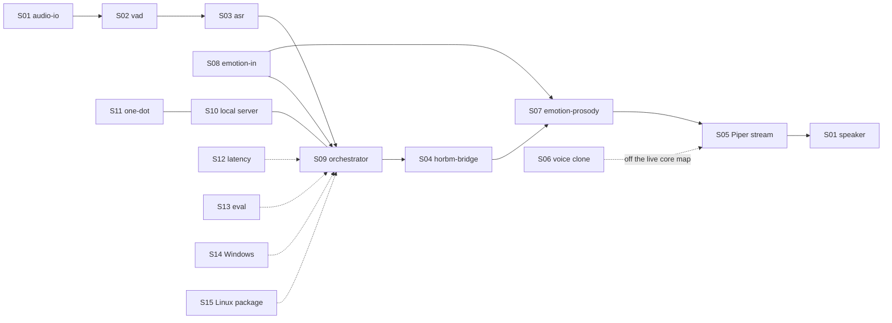
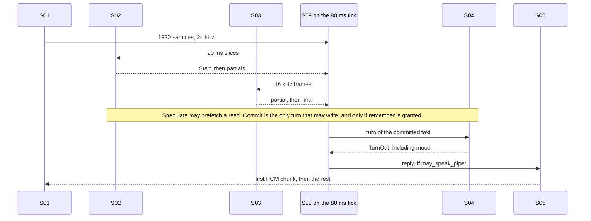

# Samantha voice stack — architecture (Swarm 16)

SPDX-License-Identifier: MIT

Copyright (c) 2026 Galion Labs

Perpetual Open MIT License.

This file is the contract for the local Samantha companion: microphone, VAD, ASR, the HORBM brain, mood, Piper, speaker. It is a design. It is not a latency result. Nothing in this change was timed, and crate `horbm` is not in this repository.

The types that can be compiled today live in [`contract/`](contract/) (`galion-sam-contract`). Wiring after the other sectors land is [`INTEGRATION.md`](INTEGRATION.md).

## What this stack is

Samantha, on the owner's machine, CPU only. She is the internal test voice already described in [`docs/galion-voice-v2/personas/SAMANTHA.md`](../docs/galion-voice-v2/personas/SAMANTHA.md): warm, close, playful, a woman's voice, short plain English, emotionally present. Emotion is the live mood, not a scripted line. `galion_emotion::persona::CANNED_EMPATHY` stays `false`.

The live mouth is the warm Piper already in the tree (A21 pin, out of process, core 6). [`docs/galion-voice-v2/personas/voice/samantha.toml`](../docs/galion-voice-v2/personas/voice/samantha.toml) sets `[fallback.piper] is_film_voice = false` and `[worker] device = "cpu"`. This document does not claim the Piper checkpoint is a performer. The clone worker is S06. It stays off the live core map: `crates/galion-cores` gives clone workers no cores during a live call.

The brain is crate `horbm` behind the trait in `contract`. This stack does not reimplement retrieval, and it does not call Hermes, Groq, Qwen, or any other completion API. The existing phone lane (`GALION_LLM=hermes` in `deploy/systemd/templates/galion-voice-stage.service`) is a different process. S15 does not edit that unit.

## Sectors

Each sector opens its own draft pull request. The branch is `swarm16/<sector>`. The tree it adds is `voice-stack/<sector>/`. This sector is the exception: branch `swarm16/architecture`, files here and in `contract/`.

| Id | Branch | Directory | Reuse, do not rewrite |
|---|---|---|---|
| S01 | `swarm16/audio-io` | `voice-stack/audio-io/` | `galion_console::mic::MicSource` (one 80 ms frame). `LiveMic` is a stub that returns `MicError::NoDevice`. S01 is the real device. Resample with the approach in `galion_v2_live::audio` (linear is what that file already calls adequate for the ASR feed). Capture at 24 kHz mono, or resample to it before the heartbeat. |
| S02 | `swarm16/vad` | `voice-stack/vad/` | `galion_v2_live::vad::Vad` and `endpoint::Endpointer`. Event names are `EndpointEvent` in the contract: `None`, `Start`, `Speculate`, `Resume`, `Commit`, `Hold`. Defaults stay `spec_ms = 60`, `commit_ms = 160`, `hold_ms = 500` until S02 publishes a measurement. |
| S03 | `swarm16/asr` | `voice-stack/asr/` | `galion-asr-vosk`, protocol `galion-asr-vosk/1`, 16 kHz, 20 ms / 320 samples, out of process. `libvosk` stays inside that process. A missing model is an error, not a guessed transcript. `clean_transcript` drops `[unk]`. |
| S04 | `swarm16/horbm-bridge` | `voice-stack/horbm-bridge/` | Trait `Brain` only. `Brain::open(memory_db, knowledge_dir, cases)`, `turn(&str) -> TurnOut`. Depend on `horbm-memory` from `https://github.com/galion-studio/galion-knowledge` rev `761a7f225304fc010379219e5b88c6669dd48f40` when the bridge compiles. Do not vendor `horbm`. Do not fall through to `GALION_LLM`. |
| S05 | `swarm16/tts-piper-stream` | `voice-stack/tts-piper-stream/` | `galion_v2_live::piper::Piper`: one JSON line in, raw s16le on stdout, warm process. Runtime is `runtimes/galion-piper-rt`, its own workspace, excluded from the root workspace. Do not add `ort` to any Galion workspace member. |
| S06 | `swarm16/samantha-voice-clone` | `voice-stack/samantha-voice-clone/` | `galion-clone-cbx` and the clone child described in the root README. Offline. No cores on a live call. No audio files in git. |
| S07 | `swarm16/emotion-prosody` | `voice-stack/emotion-prosody/` | `ProsodyControl`, `PiperVoiceProfile` `SAMANTHA`, and the `e0` / `e1` table in `samantha.toml`. Map from `Pad`. Do not map by copying into `EmotionFrame`. |
| S08 | `swarm16/emotion-in` | `voice-stack/emotion-in/` | `AffectEstimator`, `EmotionFrame`, `EmotionWire`, `ConsentGate`. Default deny. |
| S09 | `swarm16/pipeline-orchestrator` | `voice-stack/pipeline-orchestrator/` | Heartbeat stays on core 0. The turn runs beside `Heartbeat::step`, the same rule as `galion-openmind`. Pin with `galion_cores::CoreRole`. Barge-in uses `AudioOut::stop`. |
| S10 | `swarm16/local-server` | `voice-stack/local-server/` | Loopback only, same family as `galion-render`'s blocking HTTP. Protocol below. Do not replace port 7878. |
| S11 | `swarm16/one-dot-ui` | `voice-stack/one-dot-ui/` | `galion_render::dot::DotState`: `idle`, `listening`, `speaking`. `LOCKS.toml` `[ui]`: one solid dot `#F5F5F7` on `#0A0A0C`. Gradient is background only. No chrome, no text, no waveform. |
| S12 | `swarm16/latency-harness` | `voice-stack/latency-harness/` | `galion_console::live::StageTimer` and `contract::budget`. A missing sample is absence, not `0`. |
| S13 | `swarm16/eval-golden` | `voice-stack/eval-golden/` | `galion-gates`, `galion-presence-eval`. Text fixtures. No Samantha, Jarvis, s711, reference, or clone audio in the tree. |
| S14 | `swarm16/windows-install` | `voice-stack/windows-install/` | Home `G:\galion` when `GALION_HOME` is unset. Install does not copy wav, mp3, flac, ogg, or opus into the repo. |
| S15 | `swarm16/linux-package` | `voice-stack/linux-package/` | A new unit template under this directory, loopback, no key material. Do not edit `deploy/systemd/` and do not install or restart a unit. |
| S16 | `swarm16/architecture` | `voice-stack/` | This file, `INTEGRATION.md`, and `contract/`. |



Mood ticks on the bus. The turn does not.



## Clock and cores

`LOCKS.toml` `[clock]`: `frame_ms = 80`, `frame_hz = 12.5`, `frame_budget_p95_ms = 60`. The 80 ms figure is the heartbeat. Work that runs inside `Heartbeat::step` still has the 60 ms p95 compute budget. `galion_emotion::rika::FRAME_MS` is that 80. One frame at 24 kHz is 1920 mono samples.

Core map v3, from `crates/galion-cores`:

| Cores | Role |
|---|---|
| 0 | Bus, heartbeat, audio, VAD, orchestrator, and the low-priority retrieval worker |
| 1 | Vosk |
| 2–5 | This stack's brain turn (`CoreRole::Reasoning`). Not a cloud model. |
| 6 | Piper, Samantha |
| 7 | Piper, Jarvis. This companion does not start Jarvis. The core stays his so the map does not move. |

`GALION_CORE_MAP` is left as the crate already defines it. S09 calls `galion_cores` rather than hard-coding a new mask.

## Brain

```rust
fn open(memory_db: &Path, knowledge_dir: &Path, cases: &Path) -> Result<Self, Error>;
fn turn(&mut self, heard: &str) -> Result<TurnOut<Intent, Arm>, Error>;
fn tick(&mut self);
```

`TurnOut` fields, as specified for crate `horbm`:

| Field | Contract |
|---|---|
| `reply` | Spoken only if `may_speak_piper` is true. Otherwise silence. |
| `intent`, `arm` | Types from `horbm`. This tree does not name the variants. JSON carries one JSON value each, or `null`. |
| `propensity` | Forwarded. S07 does not invent a pitch curve from it. |
| `evidence`, `sources` | On the socket and in the harness. Not spoken. |
| `violations` | `> 0` means the reply is not spoken. |
| `lookup_us`, `took_us` | The brain's own counters, reported beside wall time. |
| `mood` | `Pad { arousal, valence, dominance }`. |

`Pad::RESTING` is arousal `0.3`, valence `0.25`, dominance `0.5`. `EmotionFrame::neutral` is valence `0.0`, arousal `0.3`, dominance `0.5`. Arousal and dominance match. Valence does not, and `EmotionFrame` documents valence on −1..+1. This tree does not document a range for `Pad`. S07 takes `Pad`. It does not field-copy into `EmotionFrame`.

`tick` runs once per frame and does not speak. If `horbm` has no tick and only moves mood inside `turn`, S04's `tick` is empty and the pull request says that, in those words. An empty tick must not synthesize a mood trajectory.

Defaults for `Brain::open`, overridable by the three paths:

| Host | `GALION_HOME` unset |
|---|---|
| Windows | `G:\galion` |
| Elsewhere | `$XDG_DATA_HOME/galion`, or `~/.local/share/galion` |

Under that directory: `memory/brain.db`, `knowledge/`, `cases/`. The file format is whatever `horbm::Brain::open` reads. This document does not open one. Weights and reference clips stay under the home, outside git.

A `Speculate` event may prefetch a read. It must not call a `turn` that writes. `Commit` is the turn that may speak. `Resume` cancels the uncommitted prefetch. `remember` defaults to deny, so a committed turn still does not persist unless that bit was granted.

If `horbm` is not linked, `turn` returns an error. The socket sends `error`. The mood tick, if the server is up without the brain, uses `source: "resting"` and `Pad::RESTING`. That source string is how a reader can tell a placeholder from a live tick that happens to sit on the same numbers.

## Prosody and the inbound feeling

Outbound mood is hers. It does not need `sense`.

Inbound affect needs `sense`. `EmotionWire` already drops an inbound frame when that bit is off (`galion-emotion` `encode_with_consent`). `consented_frame` in the contract does the same for the orchestrator. `adapt` is what allows that inbound frame to move her prosody. Both bits start denied (`LOCKS.toml` `[consent]`).

S07's default `ProsodyMap::map_with_caller` ignores the caller. An override that uses the caller must ignore it when `sense` is false, and when `adapt` is false. There is no table of reply sentences.

Loudness stays inside the clamps that already exist:

- `ProsodyControl::clamped` floors `energy` at `0.6`.
- `SAMANTHA.voice.energy_bounds` is `(0.60, 1.20)`.

The live path does not emit `[whisper]`, `[whispering]`, or any other `[...]` tag. `may_speak_piper` rejects a bracket tag. The clone path, offline, may keep `[laugh]` and `[chuckle]` and no other tag (`samantha.toml` `[tags]`).

`may_speak_piper` is also false when the reply is empty, when `violations > 0`, or when the whole reply is one of the four stock lines named in `SAMANTHA.md` ("I hear you.", "That sounds so hard.", "I'm here for you no matter what.", "I feel that in my soul."). The mouth stays quiet. It does not substitute a different sentence.

English only, matching that persona file.

## WebSocket `galion-samantha-ws/1`

This socket is new. [`docs/galion-voice-v2/SECURITY-EDGE.md`](../docs/galion-voice-v2/SECURITY-EDGE.md) still describes the phone path, and that path stays HTTP with no WebSocket. The nebula page uses `ws://127.0.0.1:8766` for a different schema. Neither is this protocol.

Bind `127.0.0.1:7881` only (`VOICE_WS_ADDR`). `GALION_VOICE_WS` may set another `127.0.0.1` or `::1` port. `GALION_SAMANTHA_WS` is a deprecated alias and logs one warning. Anything else, including `0.0.0.0`, refuses to start. Occupied neighbours, left alone:

| Port | Already used by |
|---|---|
| 7878 | One-dot HTTP (`scripts/run-v1-screen.sh`) |
| 7879 | Hard loop (`GALION_HARD_ADDR`) |
| 7880 | Clone worker (`GALION_CBX_ADDR`) |
| 8642 | Hermes gateway. The layer 11 Rust gateway dials `127.0.0.1:8642` only. |
| 8766 | Nebula emotion feed |
| 8787 | Node Galion Research desk (`hermes-research`). Clashes with the HORBM preview. The Rust gateway does not bind it. |
| 7911 | Galion Research gateway, layer 11 (`GALION_RESEARCH_BIND`, `127.0.0.1` only). Not 7881, 7878, 8787, 8642, or 11434. |

One process. HTTP on the same port, only:

- `GET /health` → `200` and `ok`. No token.
- `POST /session` with body `{"op":"open"}` → body `{"token","ttl_s","transport":"body"}`. A token in the query string is `400`. Same rule as the phone path. TTL default 120 s, clamp 15…900, `GALION_SESSION_TTL_SECS`.

WebSocket upgrade: `GET /v1/samantha`.

The first text frame is `hello`, within 5 s. That 5 s deadline is a choice of this file. It is not in `LOCKS.toml`.

```json
{"schema":"galion-samantha-ws/1","type":"hello","session":null}
```

`session` is the token from `POST /session`, or `null` when `GALION_REQUIRE_SESSION` is unset (local demo, same as the phone path). When that variable is `1`, a missing or unknown token closes the socket. The token is not a query parameter. `Origin`, if present, must be `http://127.0.0.1:7881` or `http://127.0.0.1:7878`. Any other origin closes the socket.

Then the server sends `welcome_json()`:

```json
{"schema":"galion-samantha-ws/1","type":"welcome","frame_ms":80,"sample_rate":24000,"dot":"idle"}
```

### Text frames, server to client

Helpers in `contract::ws` build these, except `partial` and `final`, which copy the `galion-asr-vosk` field names (`type`, `text`, `t_ms`, and `words` on a final) and add `schema`.

| `type` | When |
|---|---|
| `vad` | `start` or `end`, plus `t_ms` |
| `partial`, `final` | ASR. The UI must not call a partial a final. |
| `turn` | After `Commit`. Fields of `TurnOut`, plus `mood`. `intent` and `arm` are JSON values. |
| `mood` | Every frame. `source` is `brain` or `resting`. `pad` is arousal, valence, dominance. |
| `dot` | `idle`, `listening`, or `speaking`, plus `level` 0..1. Level is loudness of the frame being played or captured. It is not a second widget. |
| `error` | A short code. No PCM and no transcript in the string. If a backend error contains `pcm` or `transcript`, send `redacted`, matching the phone log rule. |
| `latency` | Optional, from S12. `stages` is a list of `{name, us}` for samples that exist. Omit a stage rather than writing `0` for "not taken". |

Client to server, besides `hello`:

| `type` | Body |
|---|---|
| `text` | Typed line. Label it text, not recognition. Same idea as `PhoneLane::inject_text`. |
| `consent` | `sense`, `adapt`, `remember`, `share` booleans. Omitted bits stay at their current value. Default is all false. |
| `stop` | Barge-in from the UI. |
| `ping` | Server answers `{"schema":"galion-samantha-ws/1","type":"pong"}`. |

### Binary frames

Eight-byte header, then little-endian PCM16 mono. `encode_pcm` / `decode_pcm`:

| Offset | Value |
|---|---|
| 0–1 | `G` `S` |
| 2 | version `1` |
| 3 | `0` microphone (client → server), `1` speaker (server → client) |
| 4 | `0` = 24 kHz, `1` = 16 kHz |
| 5 | `0` |
| 6–7 | `seq` u16 LE |
| 8.. | samples |

The speaker path is 24 kHz. The ASR feed is 16 kHz. S01 resamples. The server does not write these frames to disk.

Barge-in: `AudioOut::stop` on the next heartbeat, and playback has stopped by `LOCKS` `barge_in_max_ms` (200). The 80 ms tick is when the stop is requested. The 200 ms figure is the gate. They are not the same number.

## Latency

Two different clocks, already written down, plus the swarm bar.

| Limit | Where it is written | What it bounds |
|---|---|---|
| 80 ms frame | `LOCKS.toml` `frame_ms` | The heartbeat. One frame of audio. |
| 60 ms p95 | `LOCKS.toml` `frame_budget_p95_ms` | Compute inside that frame. |
| 240 ms | `docs/galion-voice-v2/sprint-v2/latency-240/BUDGET.md` | End of user speech → first content audio, on the plan named in that file. This stack does not replace that plan and does not report a new end-to-end number. |
| 80 ms per streaming stage | This swarm | A ceiling on each stage's own compute, where a stage can be timed. Summing the ceilings is not an end-to-end budget. |

`contract::budget::STAGE_BUDGETS` is the table the harness uses. Ceilings are limits. The notes name older figures so nobody quotes them as a run of this stack.

| Stage | Ceiling | Why it is not just 80 ms |
|---|---|---|
| `audio_in` | 60 ms | On the heartbeat thread. |
| `vad_compute` | 80 ms | The `push` call. The silence wait is `endpoint_hang`, which has no ceiling in this table. |
| `asr_final` | 80 ms | BUDGET.md's 15 ms budget and 19.9 ms p50 are an earlier stack. |
| `horbm_turn` | 80 ms | `took_us` is unmeasured here. |
| `horbm_lookup` | none in this table | Report `lookup_us`. A research note on branch `cursor/horbm-r1-retrieval-core-690c` recommends ≤5 ms p95 for the diary. That note calls the figure an opinion, not a measurement. |
| `prosody` | 80 ms | `affect_to_voice_max_ms` remains 160. |
| `emotion_in` | 2.4 ms | 3% of the frame (`affect_overhead_max_pct`). |
| `tts_first` | 80 ms | BUDGET.md p50 71.3 ms and budget 30 ms are an earlier stack. A comment in `archive/2026-11-24/crates/galion-v2-live/src/piper.rs` records a different warm TTFA (29/33 ms, n=20). This file does not reconcile those runs. |
| `playback`, `ws_write` | 80 ms | Unmeasured here. |
| `dot_present` | 1 ms | `present_max_ms`. |

S12 prints microseconds and whether `over_ceiling` is true. It does not print a pass for the whole companion.

## What a review of a `swarm16/*` pull request rejects

- Any committed audio: `wav`, `wave`, `mp3`, `flac`, `ogg`, `opus`, `aiff`, `cbxvoice`, including a file whose name contains Samantha, Jarvis, s711, reference, or clone. A hash of a clip copied into a new file counts when the clip itself is added.
- A secret, a key, a token, a `.env`, or a server address that is not loopback. `127.0.0.1` and `::1` are fine. A public IP is not.
- A new `LICENSE` whose bytes differ from the repository `LICENSE`. SPDX `MIT` and `Copyright (c) 2026 Galion Labs` on new files is the line this swarm uses. Do not invent a second licence.
- `candle`, `ort`, `tract`, `burn`, `llama`, or `ggml` added to a workspace member. The Piper `ort` pin stays inside `runtimes/galion-piper-rt`.
- A cloud or paid model call, or a fallback from a missing `horbm` into `GALION_LLM`.
- A public bind, a change under `deploy/` that would be applied to a host, or a merged pull request. Draft only.
- A spoken stock-comfort line, a whisper tag on the Piper path, or a second on-screen widget beside the dot.
- A claim that a ceiling in this file was measured, unless the pull request attaches the command, the machine, and the numbers from that command.

`intent` and `arm` drifting into a made-up enum, when `horbm` is still absent, is a comment, not a silent rewrite. The bridge keeps the upstream types and sends JSON.
